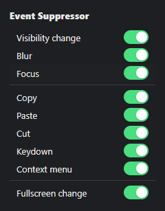

# Event Suppressor

A Chrome MV3 extension that suppresses page-level detection of tab switching, focus loss, clipboard actions, context menu, keydown, and fullscreen changes — with a per-event toggle popup.

## Screenshot
 

 

## How it works

A page-world script spoofs visibility/focus state and intercepts the relevant events before site code can see them, a background/content script keeps toggle state synced with `chrome.storage.local`, and the popup lets you flip each event category on or off per tab.

## Toggle groups

| Toggle key     | Real event types covered                                                                 |
|----------------|--------------------------------------------------------------------------------------------|
| `visibility`   | `visibilitychange`, `webkitvisibilitychange` (also drives spoofed `hidden`/`visibilityState`) |
| `blur`         | `blur` (also drives spoofed `hasFocus()`)                                                  |
| `focus`        | `focus`                                                                                     |
| `copy`         | `copy`                                                                                      |
| `paste`        | `paste`                                                                                     |
| `cut`          | `cut`                                                                                       |
| `keydown`      | `keydown`                                                                                   |
| `contextmenu`  | `contextmenu`                                                                               |
| `fullscreen`   | `fullscreenchange`, `webkitfullscreenchange`, `mozfullscreenchange`, `MSFullscreenChange`   |

All toggles default to **on** (suppression active) unless explicitly set to `false` in storage.

## Installation

1. Clone/download this repo.
2. Go to `chrome://extensions`, enable **Developer mode**.
3. Click **Load unpacked** and select the extension folder (containing `manifest.json`).
4. Pin the extension and use the popup to toggle individual suppressions per your needs.

## TODO

- [ ] Per-tab/per-site toggle instead of one global state across `<all_urls>`.
- [ ] Keyboard shortcut to quickly toggle suppressions.

## Disclaimer

This suppresses legitimate anti-cheat/proctoring signals on some sites. Use responsibly and in accordance with the terms of service of any site you use it on.